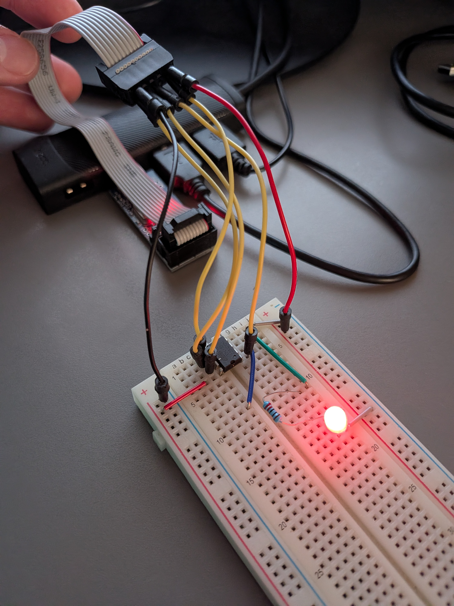
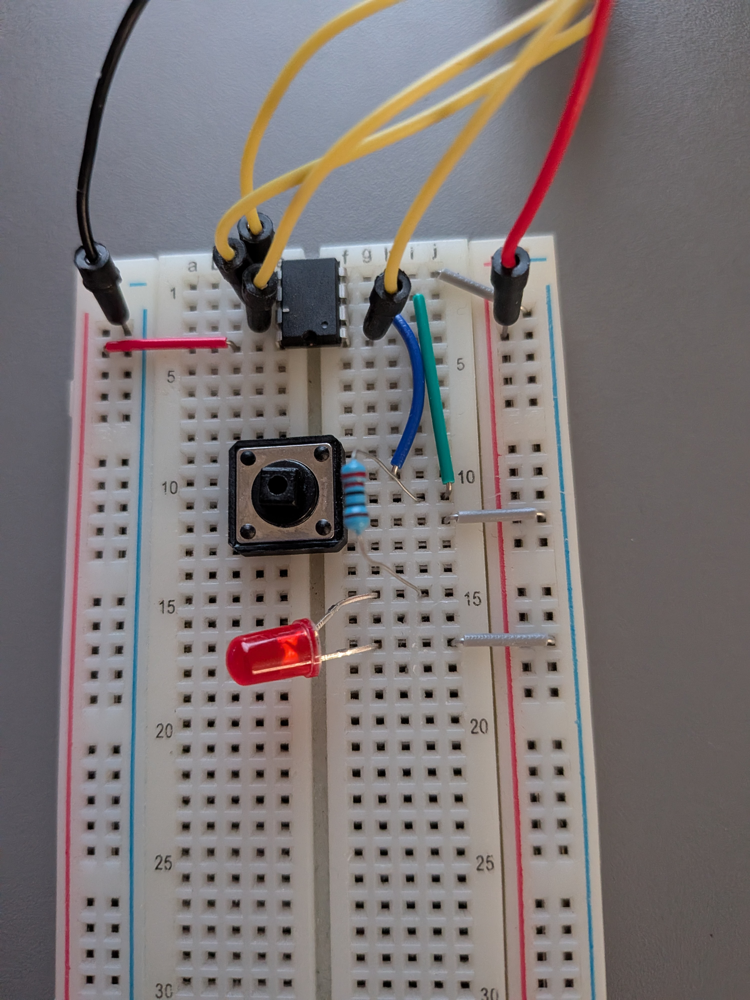
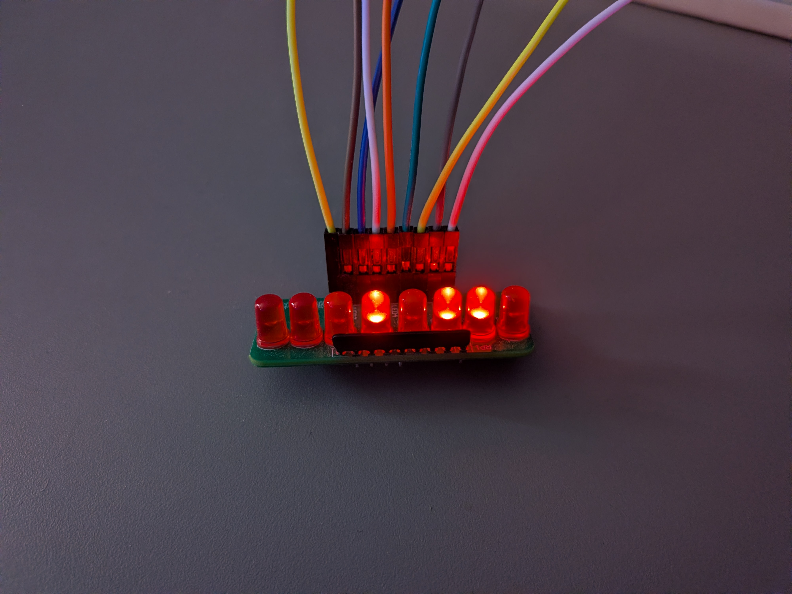
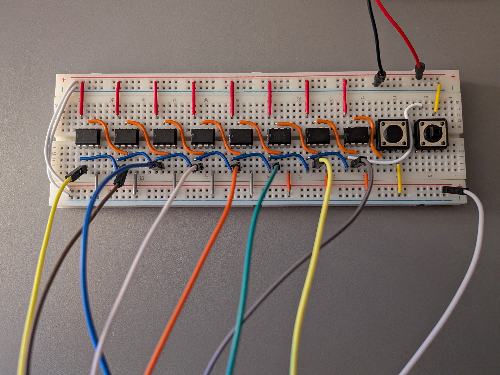
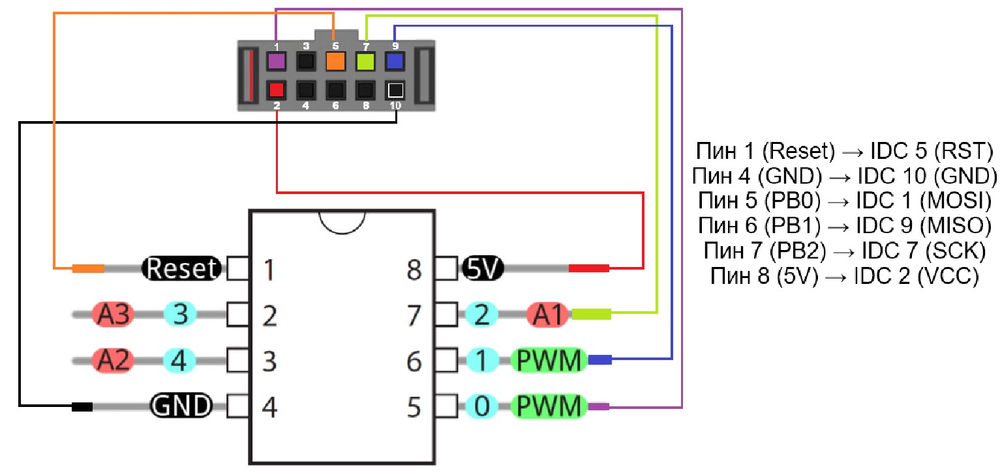

# Microcontrollers

Bare-metal AVR labs in pure C — no Arduino IDE. Built with avr-gcc, flashed with avrdude through USBasp.

## Labs

| Lab | MCU | Description |
|-----|-----|-------------|
| [simple-blink](./simple-blink) | ATtiny85 | LED blink |
| [button-blink](./button-blink) | ATtiny85 | LED controlled by a button (internal pull-up) |
| [counter](./counter) | 8 × ATtiny13A | 8-bit ripple counter: each chip holds one bit, button adds 1, reset button clears |

<p>
  
  
  
</p>



## Toolchain

- [avr-gcc 15.x](https://github.com/ZakKemble/avr-gcc-build/releases)
- [avrdude 8.x](https://github.com/avrdudes/avrdude/releases)
- USBasp driver — install via [Zadig](https://zadig.akeo.ie/) (select WinUSB)

Every lab has a `setup.ps1` that checks the programmer, detects the chip, builds and flashes:

```powershell
.\setup.ps1
```

## USBasp → ATtiny wiring

ATtiny13A and ATtiny85 share the same pinout.


