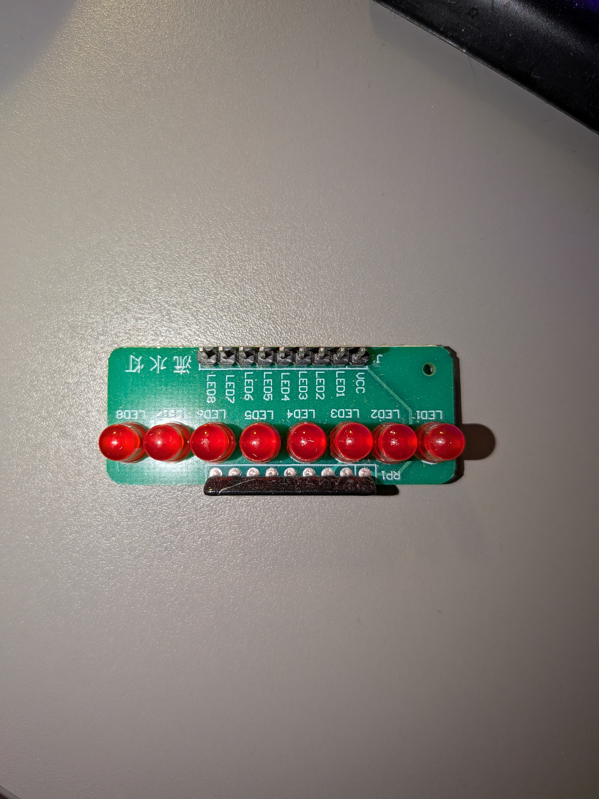

# ATtiny13A 8-bit Counter

Third bare-metal project — 8-bit ripple counter built from eight ATtiny13A chips. Every button press adds 1, the LED module shows the value in binary (0…255). Each chip holds one bit and passes the carry to the next chip.

## Hardware

- **MCU**: 8 × ATtiny13A (DIP-8)
- **Programmer**: USBasp (10-pin IDC)
- **Parts**: 8-LED module (VCC + LED1…LED8 header, built-in resistor array, active low), 2 push buttons (count, reset), jumper wires

## Scheme

- [scheme.html](./scheme.html) — schematic of all 8 chips (open in browser, the buttons are clickable)
- [breadboard.html](./breadboard.html) — breadboard layout




## Dependencies

- [avr-gcc 15.x](https://github.com/ZakKemble/avr-gcc-build/releases)
- [avrdude 8.x](https://github.com/avrdudes/avrdude/releases)
- USBasp driver — install via [Zadig](https://zadig.akeo.ie/) (select WinUSB)

## Project structure

```
.
├── counter.c         # source (same firmware for all 8 chips)
├── setup.ps1         # build & flash script
├── scheme.html       # schematic
├── breadboard.html   # breadboard layout
├── *.jpg             # photos
└── README.md
```

## Build & flash

ISP pins (PB0–PB2) are used by the counter, so chips can't be flashed in place.
Flash them one by one in the ISP slot from the previous labs, then move them to the counter board.

```powershell
.\setup.ps1
```

Repeat for every chip. The firmware is identical, any chip can go to any bit position.

Or manually:

```powershell
avr-gcc -mmcu=attiny13a -DF_CPU=1200000UL -Os -o counter.elf counter.c
avr-objcopy -O ihex counter.elf counter.hex
avrdude -c usbasp -p t13 -U flash:w:counter.hex:i
```

## USBasp → ATtiny13A wiring (ISP slot)

ATtiny13A has the same pinout as ATtiny85 — same wiring as in the previous labs.

| IDC 10-pin | Signal | ATtiny13A physical pin |
|------------|--------|------------------------|
| 1          | MOSI   | 5 (PB0)                |
| 2          | VCC    | 8                      |
| 5          | RST    | 1                      |
| 7          | SCK    | 7 (PB2)                |
| 9          | MISO   | 6 (PB1)                |
| 10         | GND    | 4                      |

## Counter wiring (every chip)

| Physical pin | Port | Role |
|--------------|------|------|
| 1            | RST  | common RST line of all 8 chips → reset button → GND |
| 2            | PB3  | LED module pin, active low (bit 0 → LED1 … bit 7 → LED8) |
| 3            | PB4  | Q out → pin 7 of the next (higher) bit chip; not connected on bit 7 |
| 4            | GND  | GND |
| 5            | PB0  | not connected |
| 6            | PB1  | not connected |
| 7            | PB2  | clock in ← pin 3 of the previous (lower) bit chip; on bit 0 — button to GND |
| 8            | VCC  | +5V |

LED module VCC → +5V.

## How it works

Each chip is a toggle stage: when its input goes 1 → 0 it flips its bit.
Bit 0 is clocked by the button (internal pull-up, press = 0). Every other chip is clocked by the previous chip's bit: when the previous bit goes 1 → 0, that is a carry, and the next bit flips.
The button input is debounced in software (20 ms).
Reset button pulls RST (pin 1) of all chips to GND at once: every chip restarts and the counter goes back to 0. RST has an internal pull-up, no resistor needed. Power cycle does the same.
After 255 the counter wraps to 0.
